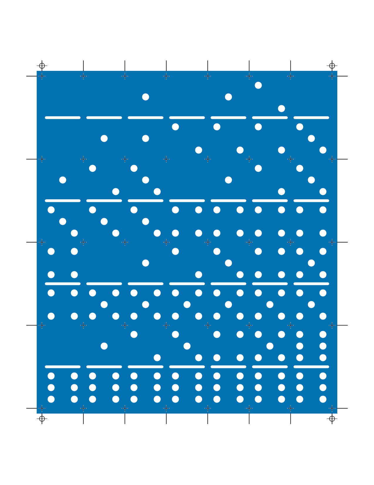
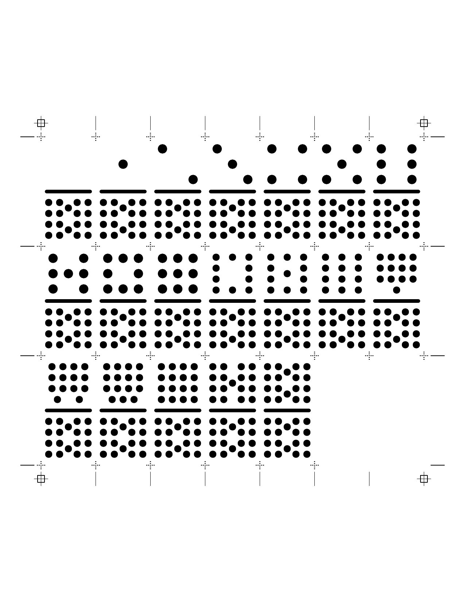

# pnp.dominoes

[](https://github.com/trevorld/pnp.dominoes/actions)
[](https://app.codecov.io/github/trevorld/pnp.dominoes)
[](https://www.repostatus.org/#wip)

### Table of Contents

* [Overview](#overview)
* [Installation](#installation)
* [Examples](#examples)
* [Related links](#related)

## <a name="overview">Overview</a>

`{pnp.dominoes}` generates print-and-play pdfs of (up to double-18) dominoes for letter and A4 paper.

* `save_domino_pnp_12()` saves a double-twelve set (91 tiles) on three sheets of tiles.

  * The first sheet contains just a double-six set.
  * The first two sheets contain a double-nine set.

* `save_domino_pnp_18()` saves a double-eighteen set (190 tiles) on six sheets of tiles:

  * The first four sheets are a double-fifteen set.
  * The first five sheets are a double-seventeen set.

* Tiles are 1" by 2" with a 1/8" bleed around each group of tiles.
  Crop marks in the margins indicate the cut lines and
  crosshairs (in the pip color) mark the tile corners on the faces.


* The first page is a cover page with credits, license, and instructions followed by a deliberately blank page.
  The remaining odd pages are the tile faces and the even pages are the tile backs.

* Registration marks on both sides help check that double-sided prints line up.
* The print-and-play pdfs are licensed under a permissive [CC-BY-4.0](https://creativecommons.org/licenses/by/4.0/) license.

## <a name="installation">Installation</a>


``` r
remotes::install_github("trevorld/pnp.dominoes")
```

## <a name="examples">Examples</a>


``` r
library("pnp.dominoes")
f12 <- save_domino_pnp_12(
	tempfile(fileext = ".pdf"),
	paper = "a4",
	background_color = palette.colors(names = TRUE)[["blue"]],
	pip_color = "white"
)
f18 <- save_domino_pnp_18(tempfile(fileext = ".pdf"))
```

The third page of the pdf is the faces of the first sheet of tiles (a double-six set) with crosshairs, cropmarks, and registration marks to aid in aligning the tile backs with the tile fronts.


``` r
grid::grid.raster(pnpmisc::pdf_render_raster(f12, page = 3L, dpi = 150))
```




``` r
grid::grid.raster(pnpmisc::pdf_render_raster(f18, page = 13L, dpi = 150))
```




## <a name="related">Related links</a>

* [{piecepackr}](https://github.com/piecepackr/piecepackr) draws the domino tiles.
* [{ppdf}](https://github.com/piecepackr/ppdf) provides the domino tile data (and setups for several domino games).
* [{pnpmisc}](https://github.com/trevorld/pnpmisc) has functions to edit print-and-play pdfs.
* [Domino Games](https://www.pagat.com/domino/) on pagat.com has rules for many games playable with dominoes.
* [Donimoes](https://donkirkby.github.io/donimoes/) is Don Kirkby's book of new puzzles and games with dominoes.
